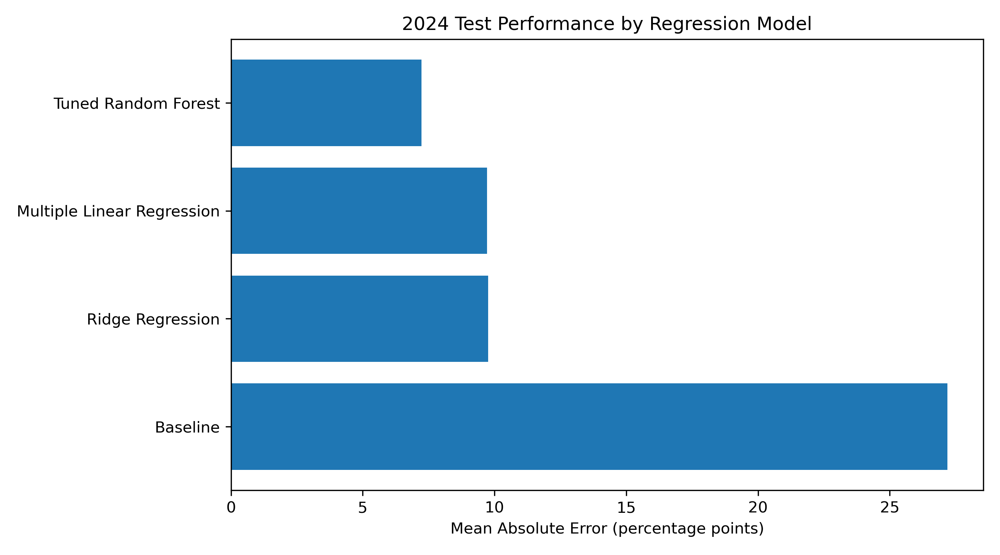
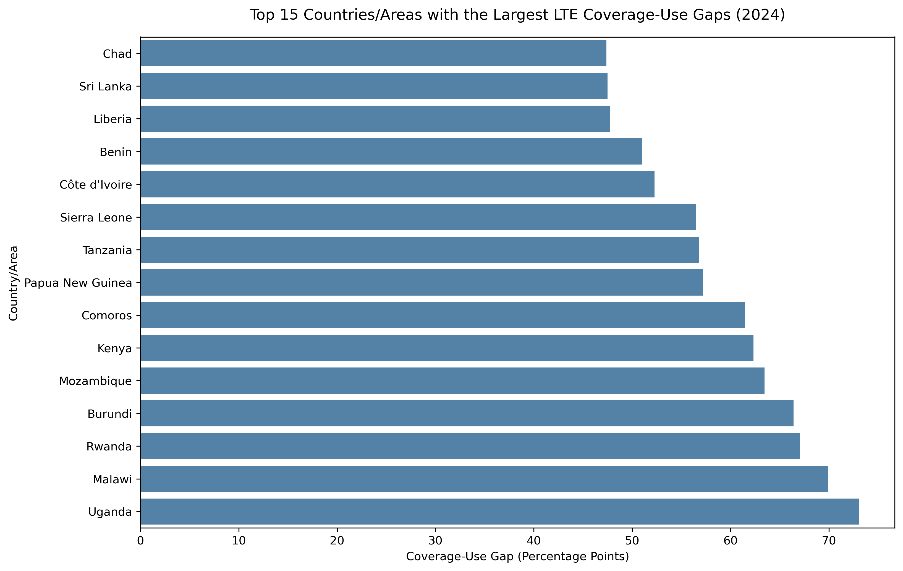
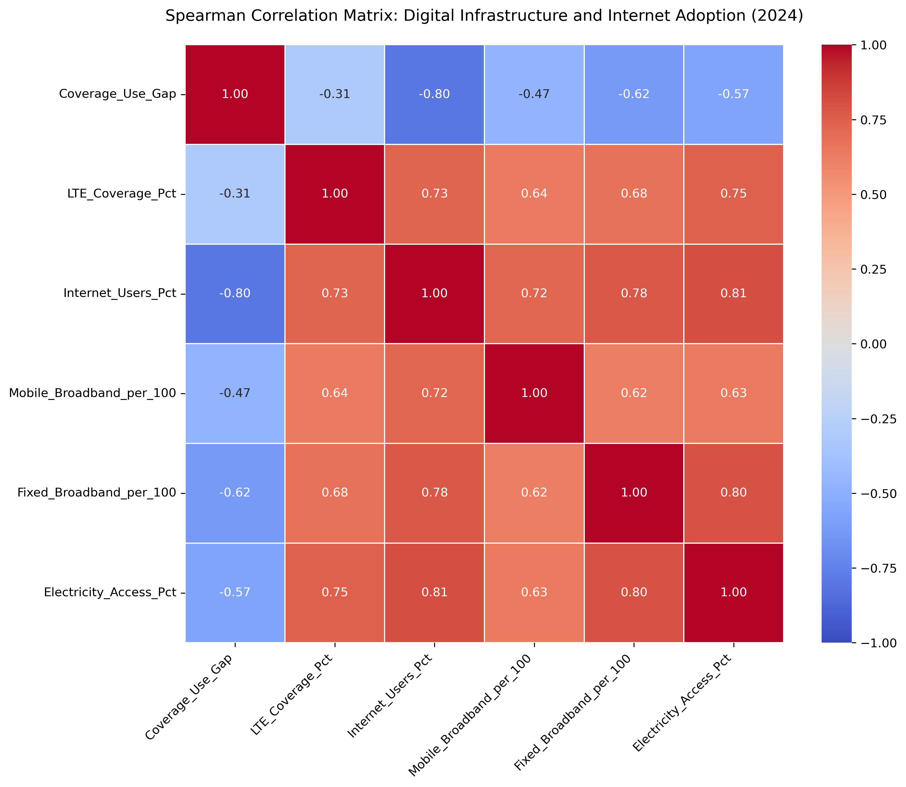
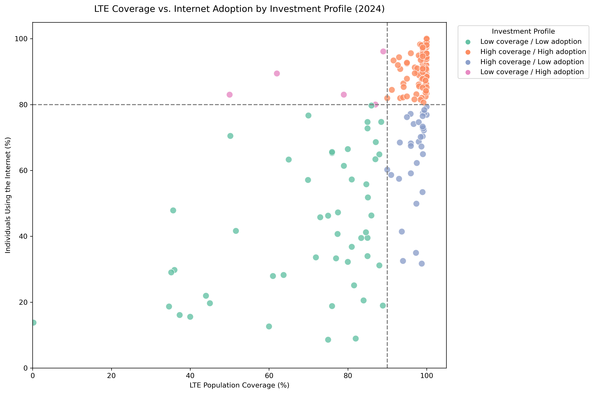
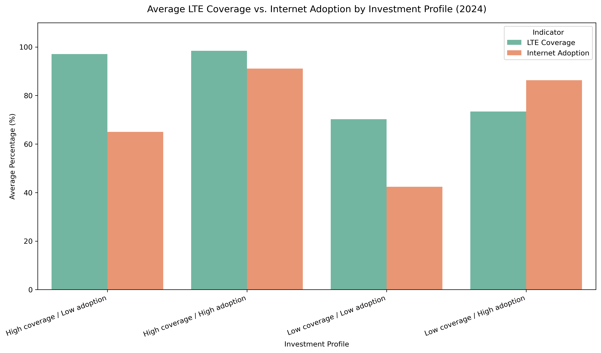

# AI Readiness & Governance Capstone

## Digital Infrastructure and AI Access
### Digital Infrastructure Investment Priority Framework

**University of Pittsburgh | Master of Data Science | Fall 2026**

## Project Overview

This capstone examines digital infrastructure and connectivity across countries as a foundation for understanding broader AI readiness and identifying barriers that may prevent nations from benefiting from advancements in artificial intelligence.

The project was developed from the perspective of a data scientist advising Jupiter's Justice, a hypothetical international development organization with limited resources for digital development.

Although the broader vision includes technological, socioeconomic, human capital, and governance indicators, this project focuses specifically on digital infrastructure availability and internet adoption.

The central stakeholder problem is:

> Where are the greatest digital infrastructure and connectivity needs, and what types of infrastructure or adoption barriers appear to be contributing to those gaps?

---

## Project Objectives

The objective of this project is to develop a data-driven decision-support framework for evaluating digital infrastructure investment needs across countries.

The analysis distinguishes between four dimensions of digital access:

1. Foundational infrastructure
2. Digital infrastructure availability
3. Household access
4. Digital adoption and use

The framework is designed to help distinguish between countries experiencing limited infrastructure availability and countries where infrastructure exists but adoption remains low.

Rather than proposing a one-size-fits-all approach to AI readiness, the project emphasizes country-specific assessments and evidence-based investment decisions.

## Research / Business Questions

1. Which countries demonstrate the largest basic connectivity gaps?
2. Where does mobile broadband infrastructure exist but adoption remains low?
3. Do observed connectivity gaps appear more strongly associated with infrastructure availability or adoption?
4. Which countries rely more heavily on mobile broadband compared with fixed broadband?
5. How does foundational infrastructure, particularly electricity access, relate to observed digital connectivity gaps?
6. How can countries be grouped into investment profiles to support differentiated infrastructure investment strategies?

---

## Data Sources

### International Telecommunication Union (ITU)

Source: https://datahub.itu.int/

Telecommunications indicators used throughout the project include:

- Population coverage by LTE/WiMAX mobile networks
- Individuals using the internet
- Active mobile-broadband subscriptions
- Fixed-broadband subscriptions
- Household internet access indicators
- Household barriers to internet access

### World Bank

Source: https://data.worldbank.org/

Supporting indicators and classifications include:

- Access to electricity (% of population)
- Total population
- Country income classifications

Subscription indicators are expressed per 100 inhabitants to support comparisons across countries of different population sizes.

Additional indicator documentation is available in the [Data Dictionary](docs/Data_Dictionary.md).

---

## Country Selection

### Experiment A

Countries were grouped by World Bank income classification and selected from different geographic regions to establish a diverse analytical sample.

The initial candidate screening pool contained 29 economies:

- 8 low-income economies
- 8 lower-middle-income economies
- 8 upper-middle-income economies
- 5 high-income benchmark economies

Candidate selection was based on income classification and geographic representation rather than telecommunications performance.

Following data availability screening and preprocessing, the final analytical sample contained 25 countries and 174 country-year observations spanning 2018–2024.

### Experiment B

Experiment B expanded the analysis beyond the original 25-country sample to include countries and areas with eligible data available through the ITU and World Bank.

The final 2024 investment-profile analysis included 185 countries and areas, excluding regional and other aggregate observations.

---

## Methodology

The project followed the Cross-Industry Standard Process for Data Mining (CRISP-DM) framework:

1. Business Understanding
2. Data Understanding
3. Data Preparation
4. Modeling
5. Evaluation
6. Deployment and Dissemination Planning

Two experiments were conducted to address the organizational objectives from different analytical perspectives.

## Experiment A — Predictive Modeling

Experiment A examined whether selected digital infrastructure indicators could predict internet adoption across 25 countries.

### Analytical Approach

- Data cleaning and preprocessing
- Missing-value assessment
- Exploratory data analysis
- Feature engineering and selection
- Temporal training, validation, and testing
- Hyperparameter tuning
- Model evaluation and comparison
- Permutation importance analysis
- Country-level prediction error analysis

### Temporal Data Split

| Dataset | Period |
|---|---|
| Training | 2018–2022 |
| Validation | 2023 |
| Final Testing | 2024 |

The selected Random Forest model was retrained using the combined training and validation observations before final testing.

### Final 2024 Test Results

| Model | MAE | RMSE | R² |
|---|---:|---:|---:|
| Tuned Random Forest | 7.224 | 10.168 | 0.872 |
| Multiple Linear Regression | 9.718 | 13.015 | 0.791 |
| Ridge Regression | 9.755 | 13.041 | 0.790 |
| Baseline (DummyRegressor) | 27.189 | 29.376 | -0.065 |

MAE and RMSE are expressed in percentage points.



### Key Findings

- Random Forest demonstrated the strongest predictive performance.
- Fixed broadband subscriptions had the highest measured permutation importance for the selected Random Forest model on the validation data.
- Prediction errors varied across individual countries.
- Differences between training and testing performance raised concerns about potential overfitting.
- Because the same countries appeared across the training and testing periods, the results do not establish generalizability to entirely new countries.

Although Experiment A demonstrated strong predictive performance, predicting internet adoption did not fully address the organization's need to identify appropriate infrastructure investments.

This distinction motivated the development of Experiment B.

---

## Experiment B — Infrastructure Availability vs. Internet Adoption

Experiment B expanded the scope of the project through descriptive analysis, examining the relationship between infrastructure availability and actual internet adoption.

### Analytical Approach

- Cross-country data integration
- Data quality and missingness assessment
- Coverage-use gap calculation
- Spearman correlation analysis
- Rule-based investment profiling
- Household internet access barrier analysis
- Comparative data visualization

### Coverage-Use Gap

The coverage-use gap was calculated as:

**Coverage-Use Gap = LTE Population Coverage (%) − Internet Adoption (%)**

Positive values indicate that LTE population coverage exceeds the percentage of individuals using the internet.

Negative values indicate that internet adoption exceeds LTE population coverage, potentially reflecting the use of other connectivity technologies.

The gap is a comparative indicator rather than a direct measurement of the number of people with LTE coverage who remain disconnected.

### Largest Coverage-Use Gaps

Countries with some of the largest observed gaps in 2024 included:

- Uganda
- Malawi
- Rwanda
- Burundi
- Mozambique
- Kenya



These findings demonstrate that extensive network coverage does not necessarily translate into widespread internet adoption.

### Infrastructure Correlations

Spearman correlation analysis identified the following positive relationships with internet adoption:

| Indicator | Spearman Correlation |
|---|---:|
| Electricity access | 0.814 |
| Fixed broadband subscriptions | 0.775 |
| LTE population coverage | 0.727 |
| Mobile broadband subscriptions | 0.724 |



Electricity access demonstrated a stronger observed relationship with internet adoption than LTE coverage.

These correlations describe statistical associations and should not be interpreted as causal relationships or predictive feature importance.

---

## Digital Infrastructure Investment Priority Framework

The primary organizational deliverable is a rule-based decision-support framework that categorizes countries according to infrastructure availability and internet adoption.

### Classification Thresholds

- High LTE coverage: 90% or greater
- High internet adoption: 80% or greater

These thresholds were established for exploratory analytical purposes and are not internationally recognized AI readiness standards.

### Investment Profiles — 2024

| Investment Profile | Countries/Areas | Average LTE Coverage | Average Internet Adoption |
|---|---:|---:|---:|
| High Coverage / Low Adoption | 33 | 97.12% | 65.04% |
| High Coverage / High Adoption | 96 | 98.40% | 91.13% |
| Low Coverage / Low Adoption | 51 | 70.20% | 42.38% |
| Low Coverage / High Adoption | 5 | 73.40% | 86.32% |
| **Total** | **185** | — | — |





### Strategic Recommendations

| Investment Profile | Recommended Assessment |
|---|---|
| High Coverage / Low Adoption | Investigate affordability, device accessibility, digital literacy, and other adoption barriers before recommending additional network expansion. |
| Low Coverage / Low Adoption | Evaluate infrastructure expansion, electricity access, and complementary adoption initiatives. |
| High Coverage / High Adoption | Investigate underserved communities that may be concealed by national averages. |
| Low Coverage / High Adoption | Examine alternative connectivity technologies and determine whether LTE expansion would provide additional benefits. |

The framework is intended to support preliminary investment assessments rather than prescribe definitive investment decisions.

Country-level results are available in:

[Country Investment Profiles — 2024](outputs/experiment_b/country_investment_profiles_2024.csv)

---

## Limitations and Ethical Considerations

- National averages may conceal rural, urban, socioeconomic, and other population-level inequalities.
- Missing or inconsistently reported indicators may disproportionately affect developing nations.
- Experiment A does not establish predictive generalizability to previously unseen countries.
- Investment-profile assignments depend on the selected analytical thresholds.
- Correlation does not establish causation.
- Household barrier data availability limits country-specific conclusions regarding affordability, accessibility, and other adoption barriers.
- The framework does not measure comprehensive AI readiness or estimate investment costs and returns.

The framework should be supplemented with local stakeholder engagement, additional socioeconomic data, human oversight, and country-specific assessments before investment decisions are made.

---

## Tools and Technologies

- Python
- pandas
- NumPy
- scikit-learn
- Matplotlib
- Seaborn
- Jupyter Notebooks
- Visual Studio Code
- Git and GitHub

---

## Repository Structure

```text
ai-readiness-governance-capstone/
│
├── All_ITU_data/        # Original ITU data extracts
│
├── data/
│   ├── raw/            # Original source datasets
│   ├── interim/        # Intermediate datasets
│   └── processed/      # Cleaned analytical datasets
│
├── docs/
│   ├── Business_Questions.md
│   └── Data_Dictionary.md
│
├── models/
│   └── experiment_a_random_forest.joblib
│
├── notebooks/
│   ├── 01_itu_data_exploration.ipynb
│   ├── 02_country_selection.ipynb
│   ├── 03_country_electricity.ipynb
│   ├── 04_itu_candidate_data_preparation.ipynb
│   ├── 05_EDA.ipynb
│   ├── 06_modeling_data_preparation.ipynb
│   └── 07_all_countries_exploration.ipynb
│
├── outputs/
│   └── experiment_b/   # Experiment B results and visualizations
│
├── reports/            # Experiment A results and earlier visualizations
├── .gitignore
├── pyproject.toml
└── README.md
```

The repository separates source data, intermediate datasets,
processed datasets, analytical notebooks, trained models,
and final outputs to support transparency and reproducibility.

The notebooks are numbered to reflect the progression of
the analytical workflow.


---

## Installation and Environment Setup

### Requirements

- Python 3.11 or higher
- Jupyter Notebook or Visual Studio Code with Jupyter support

The project dependencies are documented in `pyproject.toml`.

### Install Dependencies

From the root directory of the repository, run:

```bash
python -m pip install pandas numpy matplotlib seaborn scipy jupyter openpyxl scikit-learn joblib
```

### Launch Jupyter Notebook

```bash
python -m jupyter notebook
```

Alternatively, open the repository in Visual Studio Code and select a Python environment containing the required dependencies.

---

## Reproducing the Analysis

All notebooks use relative file paths. Maintain the existing repository structure and execute the notebooks with the `notebooks/` directory as the working directory.

### Source Data

The source datasets are located in `data/raw/`.

| Dataset | Description |
|---|---|
| `itu_all_indicators_raw_sample.csv` | Initial ITU indicator exploration |
| `nations_incomes_2026_07_15.csv` | World Bank country income classifications |
| `API_EG.ELC.ACCS.ZS_DS2_en_csv_v2_367283.csv` | World Bank electricity access data |
| `itu_selected_candidates.csv` | ITU indicators for the selected candidate countries |
| `itu_extract_all_countries_data.csv` | Expanded ITU dataset for Experiment B |
| `fixed_broadband_per_100.csv` | Fixed broadband subscriptions per 100 inhabitants |
| `All_Electricity_Data.csv` | Expanded World Bank electricity access dataset |

### Notebook Execution Order

Execute the notebooks in the following order using Restart Kernel and Run All.

| Step | Notebook | Purpose |
|---|---|---|
| 1 | `01_itu_data_exploration.ipynb` | Explore available ITU indicators and assess data suitability. |
| 2 | `02_country_selection.ipynb` | Examine income classifications and establish the candidate country sample. |
| 3 | `03_country_electricity.ipynb` | Explore electricity access data. |
| 4 | `04_itu_candidate_data_preparation.ipynb` | Prepare and screen ITU candidate country data. |
| 5 | `05_EDA.ipynb` | Integrate datasets, conduct exploratory analysis, and prepare the modeling dataset. |
| 6 | `06_modeling_data_preparation.ipynb` | Train, tune, compare, and evaluate regression models for Experiment A. |
| 7 | `07_all_countries_exploration.ipynb` | Conduct the expanded descriptive analysis and develop investment profiles for Experiment B. |

### Experiment A — Generated Outputs

Intermediate and processed datasets:

- `data/interim/itu_final_candidates_2018_2024.csv`
- `data/processed/analysis_df.csv`

Trained model:

- `models/experiment_a_random_forest.joblib`

Model evaluation outputs:

- `reports/assignment2_model_comparison.csv`
- `reports/assignment2_country_errors.csv`
- `reports/assignment2_income_group_performance.csv`
- `reports/assignment2_missingness_summary.csv`

Model evaluation visualizations:

- `reports/assignment2_model_comparison.png`
- `reports/assignment2_actual_vs_predicted.png`
- `reports/assignment2_residuals.png`
- `reports/assignment2_income_group_mae.png`

### Experiment B — Generated Outputs

Experiment B uses the expanded ITU and World Bank source datasets and does not require the trained Random Forest model from Experiment A.

Processed datasets:

- `data/processed/fixed_bb_clean.csv`
- `data/processed/barriers_final.csv`

Final analytical outputs are located in `outputs/experiment_b/`:

- `country_investment_profiles_2024.csv`
- `household_barrier_analysis_2024.csv`
- `infrastructure_correlations_2024.csv`
- `investment_profile_summary_2024.csv`

Final visualizations:

- `infrastructure_correlation_heatmap_2024.png`
- `investment_profile_comparison_2024.png`
- `lte_coverage_vs_adoption_2024.png`
- `top_15_coverage_use_gaps_2024.png`

The generated tables and visualizations support the findings and strategic recommendations presented in the final capstone report.

---

## Installation and Reproducing the Analysis

### Environment Setup

This project was developed using Python 3.11.5 and Jupyter Notebooks in Visual Studio Code. Project dependencies are documented in `pyproject.toml`.

Install the required libraries:

```bash
python -m pip install pandas numpy matplotlib seaborn scipy jupyter openpyxl scikit-learn joblib
```

### Reproducing the Results

1. Clone or download the project repository.
2. Install the required dependencies.
3. Ensure the source datasets are available in `data/raw/`.
4. Open the notebooks using Jupyter or Visual Studio Code.
5. Maintain the existing folder structure and use `notebooks/` as the working directory.
6. Execute each notebook in numerical order using Restart Kernel and Run All.

### Notebook Workflow

| Notebooks | Purpose |
|---|---|
| 01–03 | Data exploration, country selection, and electricity access analysis |
| 04–05 | Data preparation, integration, and exploratory analysis |
| 06 | Experiment A: Predictive modeling and evaluation |
| 07 | Experiment B: Descriptive analysis and investment profiling |

### Analytical Outputs

- `data/interim/` — Intermediate datasets
- `data/processed/` — Processed analytical datasets
- `models/` — Trained Random Forest model
- `reports/` — Experiment A results and exploratory visualizations
- `outputs/experiment_b/` — Experiment B results, investment profiles, and visualizations

Experiment B can be executed independently of Experiment A using its corresponding raw datasets.

---

## Future Development

Future development of this project may include:

- Incorporating human capital and AI governance indicators
- Expanding affordability and digital literacy analysis
- Evaluating investment-profile threshold sensitivity
- Developing an interactive country-level dashboard
- Automating data ingestion and processing
- Incorporating subnational data to identify underserved communities
- Exploring causal inference methods to evaluate potential infrastructure interventions

The long-term objective is to develop a more comprehensive and ethically informed AI readiness decision-support framework.

---

## Project Status

**Capstone Analysis Completed — Fall 2026**

- [x] Business understanding and research objectives
- [x] Data acquisition and preparation
- [x] Exploratory data analysis
- [x] Experiment A — Predictive modeling
- [x] Experiment B — Descriptive analysis
- [x] Investment-profile framework
- [x] Final analytical visualizations

This project represents an academic decision-support prototype and has not been deployed in a production environment.

---

*The goal of closing the digital divide is not merely to connect more devices, but to create more opportunities for the people behind them.*
